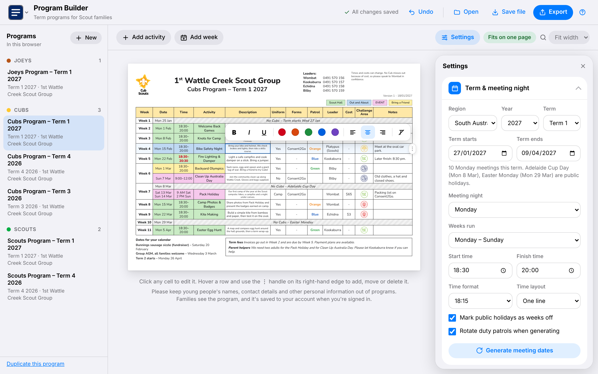
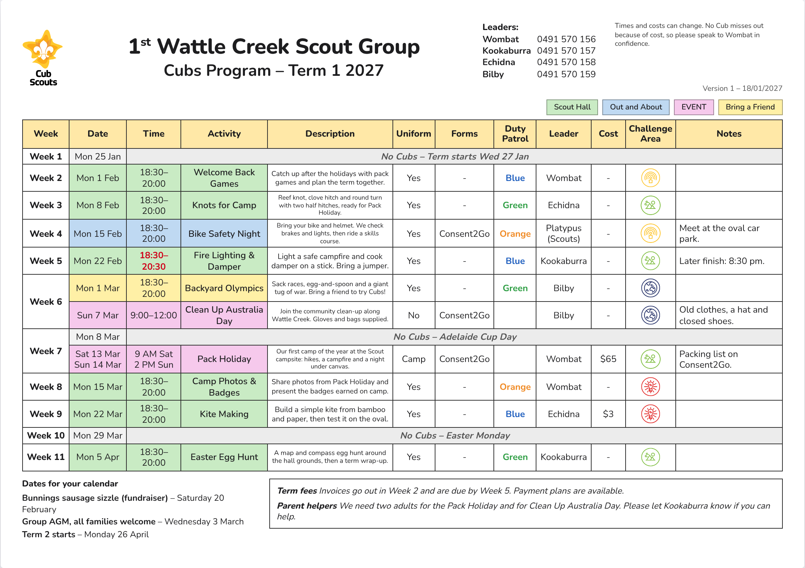
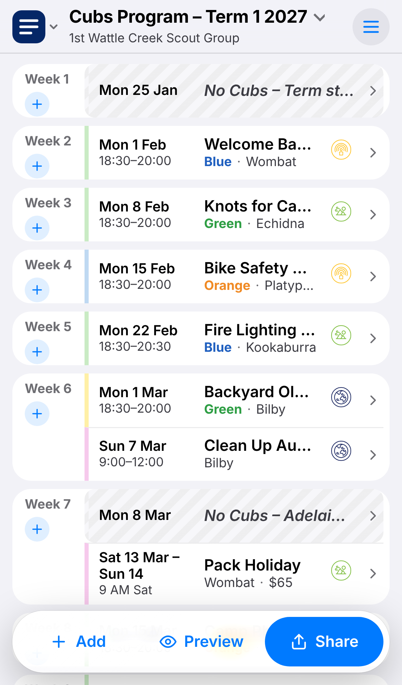

# Scout Program Builder

A small web app for building a term program to share with Scout families. It runs entirely in the browser and is hosted on GitHub Pages. There's no server and no build step.

**Use it:** [program.qstored.org](https://program.qstored.org/)



<sub>Made with `node scripts/screenshots.js`.</sub>

## Example



This example was made in the app. The group, leaders and activities are made up, and the phone numbers are from the 0491 570 range that ACMA reserves for fiction. It shows:

- **Generated meeting nights:** Mondays for SA Term 1 2027. The term starts on a Wednesday, so Week 1's Monday is shown as a week off ("No Cubs – Term starts Wed 27 Jan") and the first meeting is in Week 2. Adelaide Cup Day and Easter Monday became weeks off automatically.
- **Patrols** (duty patrols) rotating Blue, Green, Orange, skipping the weeks off.
- **A weekend camp over two days** (Pack Holiday, Saturday to Sunday) and a **Sunday community event**, each grouped into its week.
- **Highlight colours and challenge areas:** all four of each, with the legend.
- **The leader picker,** including a visiting leader from another section, "Platypus (Scouts)".
- **Uniform** as Yes, No or Camp, plus **Forms** and **Cost**.
- **A red, bold time** for a changed finish time.
- **A heading note** and **version note** beside the leaders.
- **Dates for your calendar and notes** under the table. The dated lines also go into the calendar file.

To try it, download [`examples/example-program.json`](examples/example-program.json) and use **Open** in the app.



## Features

- **Programs on the left, settings on the right.** The left column lists your programs (in your account once signed in), grouped by section in the Scouts order, Joeys to Rovers, each section newest term first; click one to open it, start a *New* one, duplicate the open one, or delete one. The « button folds the list to a thin strip, and » brings it back. The settings (term, styling, leaders, columns and lists) are in a pane that floats on the right: *Settings* above the program hides and shows it, and the program makes room beside it rather than going under it. Both stay as you left them.
- **Set up on the first visit.** A short wizard asks for the group's name, the section, the term (state, year, term and meeting night; it suggests the current or next term and fills in the meeting nights) and, optionally, the leaders (contact details optional too; with them, each activity's leader can be picked with a tap, and you choose whether they're listed at the top of the program). Tick *Start with example activities* to have your term's meeting nights filled with the example program's activities, using your group, section, term and leaders, to change to your own (an empty program offers this too). Then a tour points out the settings, the program, the buttons for dates and activities, saved programs, files and printing. On a phone the tour covers the week list, Add, Preview, Share, the title and the menu. Take it again with *Take the tour* at the foot of Settings, in **Help**, or in the phone menu. Anyone who already has programs saved isn't shown the wizard.
- **Generates meeting dates automatically.** Pick the region, year, term and meeting night, and you get one row per meeting with its term week number. Weeks can run Monday–Sunday or Sunday–Saturday. If the term starts partway through a week, after the meeting night, that whole week is still Week 1 and its meeting night is shown as a week off ("No Cubs – Term starts Thu 28 Jan"). The same goes for a term that ends partway through its last week, before the meeting night ("No Cubs – Term ends Fri 11 Dec"). Meeting nights on a public holiday automatically become weeks off, such as "No Cubs – Labour Day", and don't use up a duty patrol turn.
  - **Term dates** are built in for every state and territory: SA 2025–2028, VIC 2026–2029, QLD and WA 2026–2028, and NSW (Eastern and Western divisions), TAS, ACT and NT 2026–2027. For other years or places, choose *Other / custom* and type the dates. ACT and NT dates come from sources quoting the official tables, because their sites couldn't be reached, so double-check those.
  - **Public holidays** are worked out from each state's rules, and checked against data.gov.au (2021–2025) and, for SA, SafeWork SA's 2025–2028 list. They include part-day holidays that clash with evening meetings (SA and NT Christmas Eve and New Year's Eve from 7pm, QLD Christmas Eve from 6pm). Regional or restricted days are left out (show days, NSW Bank Holiday, Hobart Regatta, TAS Recreation Day and Easter Tuesday), as are WA holidays from 2028 (WA's law changes) and Victoria's AFL Grand Final Friday until it's announced each year. Add any of those as weeks off.
- **Edit in place.** Click any cell on the page preview to type. Clicking a date shows the seven days of that row's week: pick one and the date fills in. The picker also takes a full date, a multi-day end date or custom text like "Sat or Sun 7 or 8 Nov". Clicking a time opens a time picker: *Starts* and *Finishes* boxes (a new start keeps the same length), quick choices (*Meeting night*, *TBA*, *No time*), and *Shown as*, the text in the cell, which you can type over with anything, like "Pick up 9 AM" or "9 AM Sat" and "4 PM Sun" on two lines (Shift+Enter). Picked times follow your *Time format* and *Time layout*. The phone editor has the same, with the phone's own time pickers. Clicking a challenge area, duty patrol, leader or uniform cell lets you choose from a list (uniform is Yes or No, with *Other* for things like "Camp"). Leaders come from your *Leaders* list, and *Other leader* adds someone from outside the section (e.g. "Roo (Joeys)"), who is then offered for other rows too. Renaming a leader updates the program.
- **Text formatting.** While you're editing a text cell on the program (activity, description, notes and the other typed-in columns, and a week off's text), a small toolbar hovers above it: **bold**, *italic*, underline, a colour (red, orange, green, blue or purple; the same one again takes it off) and clear formatting, plus the cell's alignment (left, centre or right; the column's own alignment is the default), for the selected text or what you type next. Ctrl+B, Ctrl+I and Ctrl+U (⌘ on a Mac) work too. The phone editor's text fields have the same toolbar. The formatting prints and goes into the PDF; the calendar file and spreadsheet get the plain text. The text fields in Settings that print (group name, title, version note, heading note, footer, the Leaders heading and each leader's name and contact, the Dates & notes headings and each line) have a smaller toolbar for the whole field: bold, italic and a colour (red, orange, green, blue or purple). The field shows the style as you set it. Fields that print bold or italic anyway (the group name, title, headings, leaders' names, date names and the notes) show that as already on: turn it off to print them plain, and *Clear* makes them fully plain.
- **Heading note.** Optional text at the top right beside the leaders (e.g. "NOTE: Costing & dates subject to change…"). It moves under the heading if there isn't room.
- **Styling picked cells.** The cells you pick rather than type (Date, Time, Patrol, Leader, Uniform) take bold, italic and a colour for the whole cell, e.g. a changed start time in red. The style toolbar appears above the cell while its picker is open. In the phone editor, use **Aa** beside the field's name. Picked cells and *Week* cells can be aligned left, centre or right from the same toolbar. A *Week* cell takes a style too, for the whole week: click it (or **Aa** beside *Week* in the phone editor). It stays with that week whatever happens to its activities. (This replaces the row menu's old *Red text*; red text in older programs and spreadsheets is kept.)
- **Row options.** Hover over a row and use the **⋮** handle on its right-hand edge to add an activity below or above (in the same week), duplicate, move, highlight or delete it. Rows in the same week share one merged *Week* cell. *Move to Week N* shifts an activity a whole week up or down, keeping its weekday. It can go past either end of the term too: the activity then shows in a *Hols* week (e.g. *Move to Hols (14–20 Dec)*). An empty week can be moved the same way from its row menu.
- **Whole weeks.** *Add week* adds an empty week before the first week or after the last, e.g. a holiday camp the week before term. It shows on the program as its week and dates with a blank row, and the editor shows *Add an activity to this week*. To add an activity on any day of a week, use the **+** on its Week cell and pick the day. The meeting night keeps the usual time; other days start with no time. An empty week is replaced as soon as anything is dated in it, can be made a week off from its row menu, and isn't included in the calendar file or spreadsheet. On a phone, *Add* has *Week before*, *Week after* and *Activity on another day*, and each week has a **+** under its label.
- **Weeks off.** *Mark as no meeting* in a row's menu makes it a week with no section night (public holiday, school holidays, or your own text). It shows as a shaded row across the table, keeping its Week and Date. On a phone, *Add → Week off* does the same for a date. Weeks outside the term dates show "Hols" (changeable under *Page & layout*).
- **Always in order.** Rows sort themselves by date, then start time ("18:15", "6:30 PM" and "9 AM" are all understood). Activities without a time, like "TBA", go last on their day. Changing a time re-sorts when you leave the cell.
- **Easy for anyone to pick up.** The settings most leaders need (term, styling, leaders, dates & notes, patrols) come first; columns, challenge areas, highlights and page layout wait under **More settings**. Wording is plain (*Fits on one page*, no file extensions), *All changes saved* by Undo shows that work is kept, and the **?** beside Export opens **Help**: short answers to everyday questions (change the term, add an activity, mark a week off, print or send to families, give it to another leader, use another computer, undo), with the tour a button away.
- **Fits one page.** Text shrinks until the program fits on one A4 or Letter page. If there's spare room, rows stretch to fill it. If it can't fit, it prints over several pages with the table header repeated, and the preview marks where each page break will fall.
- **Words never break.** If a word doesn't fit its column, the column widens by borrowing room from columns with space to spare. If that isn't enough, that cell's text shrinks (to no less than 70% of the table text), and as a last resort the whole table shrinks. Dates stay on one line.
- **Descriptions fit two lines.** Each description shrinks on its own to stay within two lines, or the height of the tallest other cell in its row. This can be turned off under *Page & layout*.
- **Styling.** Group name ("1st" is shown as a superscript), section preset (Joeys, Cubs, Scouts, Venturers, Rovers or custom) with the official section logo (with the section's name under it, or the emblem alone) and colour, title template, your own logo upload, font, leaders and their contact details (phone or email), listed at the top or not (*Show the leaders at the top of the program*; either way they can be picked for each activity), version note and footer.
- **Dates & notes.** A section under the program, like the Joey program's: *Dates for your calendar* (fundraisers, camps, group events) on the left and a box of notes on the right. Edit it under *Dates & notes* in Settings (or the phone menu). Give a line real dates and its text is written for you ("23–25 October"), and it's added to the calendar file. The section is left out when empty, and a new term's program starts without it.
- **Columns.** Show or hide, rename, reorder and set the alignment of each column. To resize, drag the line between two headings on the desktop, like a spreadsheet. Drag the Date column narrow and dates wrap with the day above the date ("Tuesday" over "13 October"). A column never goes narrower than its longest word, so a drag that reaches that point carries on into the next column. If you hide *Time*, the time moves into the date cell, and the date picker has a button to set it.
- **Lists.** Highlight colours with a legend (Scout Hall, Out and About, EVENT, Bring a Friend, …), challenge areas using the official Scouts Australia icons (you can upload a different icon for any area), and duty patrols with colours, which rotate automatically when dates are generated.
- **Several programs.** **Programs** lists every program saved in this browser (for example Cubs T4 and Scouts T4, or last term's), to open, duplicate or delete. *New program* (in **Programs**) starts another one for the same or next term, keeping your branding, leaders, columns and lists. Everything saves automatically. **Save file** saves the whole program as a file (in Chrome and Edge on a computer it opens a *Save as* box to choose the name and folder; other browsers download it), and **Export** has the activities spreadsheet:
  - **Activities spreadsheet (.csv)** (*Export*) opens in Excel, Google Sheets or Numbers, so another leader can fill in or fix activities and send it back. Dates are written like "Tue 13 Oct 2026" so spreadsheets leave them alone. Day/month/year dates, renamed headings and missing columns are all handled when it's opened again.
  - **Full program (.json)** (*Save file*) keeps everything, including branding, logo, leaders, lists and settings.

  **Open** accepts either. A spreadsheet's activities can replace the current program's activities or start a new program with the same branding.
- **Calendar file.** **Export → Calendar for families** downloads an `.ics` file that families can open to add the program to Google, Apple or Outlook calendars. Each meeting has its times (read from the Time cell), location (*Where*) and details. Anything typed as "-" (meaning none) is left out. Untimed items are all-day events, and weeks off are included as free all-day entries.
- **PDF made in the app.** **Export → Save as PDF** builds the PDF itself, so it's identical in every browser. iPhone and iPad Safari ignore a page's print orientation and add their own margins, so on those devices **Export → Print** opens this PDF instead, and iOS's viewer prints it correctly. (The first PDF loads two small libraries from cdnjs, so it needs to be online.)
- **Export → Print.** Uses the browser's print dialog. Choose *Save as PDF* (the file is named after the program, e.g. "Cubs Program - Term 4 2026"), and turn off the browser's own *Headers and footers* option.

### Look and dark mode

The app's controls share one look with Beacon, Snag Calc and the [homepage](https://no5tyle.github.io/): Apple's system colours and font, rounded cards, capsule buttons and see-through bars. The colours, rounding and font come from the shared stylesheet, https://no5tyle.github.io/shared/no5tyle.css (kept in [no5tyle.github.io](https://github.com/no5tyle/no5tyle.github.io)), which `index.html` links before `css/app.css`. It switches to dark mode with your device. The program sheet itself always stays white, on screen, in print and in the PDF.

### On phones and tablets

Phones and tablets get a touch-friendly view instead of editing the sheet directly:

- **Week list.** A short list with one row per activity (date, time, activity, patrol and leader), so a whole term fits on about a screen. Tap the title to switch programs.
- **Activity editor.** Tap a row to edit it. You get day buttons for its week, big text boxes, and tap-to-pick patrol, leader, challenge area and highlight. From there you can mark it as no meeting, move it a week, duplicate or delete it, or add another activity that week.
- **Add.** Adds an activity on the next free meeting night, or a week off.
- **Menu.** Programs, new, open, generate dates and undo, plus every section of the desktop's Settings, each on its own screen.
- **Preview.** Shows the real printed sheet (pinch to zoom) and whether it fits one page.
- **Share.** **Program PDF** makes the PDF in the app (always the right page size and orientation, on one page when it fits), then opens the share menu so you can print, email, message or save it. You can also send the calendar file, activities spreadsheet or full program file.

The menu's *Use the desktop editor* switches back to the sheet editor, and *Switch to the mobile view* (at the foot of the desktop's Settings) does the reverse.

Desktop editing works in current Chrome, Edge, Firefox and Safari.

## Hosting on GitHub Pages

Every push to `main` is tested and then published by `.github/workflows/pages.yml` (in **Settings → Pages**, **Build and deployment** is set to **GitHub Actions**). If a test fails, the live site isn't touched.

The site is served at **`program.qstored.org`**. GitHub sends the old address, `no5tyle.github.io/programmer`, there automatically. To set the address up:

1. **Verify the domain** for the `no5tyle` account: your profile's **Settings → Pages → Add a domain**, `qstored.org`. GitHub shows a TXT record (`_github-pages-challenge-no5tyle.qstored.org`) to add at the domain's DNS provider. Verifying stops anyone else's Pages site from using the domain.
2. **Add a DNS record:** `program` as a `CNAME` to `no5tyle.github.io` (no path).
3. In this repository's **Settings → Pages**, enter `program.qstored.org` under **Custom domain**, wait for the DNS check, then tick **Enforce HTTPS**. The `CNAME` file in the repository records the address; with the site published by the workflow, the setting in **Settings → Pages** is the one that counts.

Each address keeps its own saved programs in the browser, so programs saved at the old address don't appear at the new one. Use **Save file** at the old address first, and **Open** at the new one. This is why the move comes before anyone signs in (`docs/premium-plan.md`, section 3.2).

## Sign in with Microsoft

The sign-in box can offer **Sign in with Microsoft**
above the email link, here and on account.qstored.org, internal.qstored.org and pinewood.qstored.org. It's off until it's set up, and
then switched on with a repository variable. Firebase does the OAuth with Microsoft, through its REST API, so
no script from Google or Microsoft is loaded (`startMicrosoftSignIn` in `js/account.js`).

1. **Register qStored with Microsoft.** In the [Microsoft Entra admin center](https://entra.microsoft.com): *App
   registrations* → *New registration*.
   - *Name*: qstored.
   - *Supported account types*: **Accounts in any organizational directory and personal Microsoft accounts**,
     so work, school and personal Microsoft accounts all work.
   - *Redirect URI*: **Web**, and the address Firebase shows in step 2 (`https://qstored.firebaseapp.com/__/auth/handler`).

   Then, under *Authentication*, add four more **Web** redirect URIs, one for each site, since each comes back
   to itself: `https://program.qstored.org/`, `https://account.qstored.org/`, `https://internal.qstored.org/`
   and `https://pinewood.qstored.org/login` (Pinewood comes back to its sign-in page).
   Under *Certificates & secrets*, make a **New client secret** and copy its *Value*; the *Overview* has the
   *Application (client) ID*.
2. **Turn it on in Firebase.** Firebase console (project `qstored`) → *Authentication* → *Sign-in method* → *Add new
   provider* → **Microsoft**: switch it on, paste the client ID and secret, and save.
3. **Keep one account per email** (*Authentication* → *Settings* → *User account linking*: *Link accounts that use
   the same email*, which is the default), so a leader's email link and Microsoft sign-ins share their programs.
4. **Try it before anyone else sees it.** On program.qstored.org, open the browser's console, run
   `ACCOUNT.microsoftSignIn = true`, then *Sign in*: the button is there for you alone, until the page is reloaded.
5. **Switch it on:** set the variable `MICROSOFT_SIGN_IN` to `true` in this repository, qstored-account,
   qstored-internal and pinewood-control (Settings → Secrets and variables → Actions → Variables), and re-run
   each one's latest publish or deploy.

**An organisation's Microsoft 365 may ask for approval.** Many organisations only let their people sign in to apps from a
*verified publisher*, or that an administrator has approved. If a leader sees *Need admin approval*, either:
- verify qStored as a publisher (*App registrations* → qStored → *Branding & properties* → *Publisher verification*,
  which needs a free Microsoft Partner Network ID and the qstored.org domain), or
- ask that organisation's Microsoft 365 administrators to approve qStored for everyone in it.

The sign-in only asks Microsoft for the leader's name and email address.

## Privacy policy and terms

Drafts are in `policies/` (`privacy.html` and `terms.html`). They aren't published yet: the publish
workflow copies only the app's own folders. To publish them, fill in the highlighted placeholders, take out
the draft notice, add `policies` to the `cp` line in `.github/workflows/pages.yml`, and set the
`PRIVACY_URL` and `TERMS_URL` variables to their addresses (`https://program.qstored.org/policies/...`).
*Sign in* (and the qStored account site) then link to them. The support address on them comes from `SUPPORT_EMAIL`.

## Running locally

Open `index.html` directly, or serve the folder:

```bash
python3 -m http.server 8000
```

## Publishing and tests

Every push to `main` builds the site folder, runs the tests against exactly those files, then publishes them (`.github/workflows/pages.yml`). If a test fails, the live site isn't touched. Pushes to other branches and pull requests just run the tests (`test.yml`).

When publishing, the `?v=` tags on the CSS and JS links in `index.html` are set to the commit, so browsers always load matching files after an update. GitHub Pages lets browsers keep files for 10 minutes.

**One-time setup:** in the repository's **Settings → Pages**, set **Source** to **GitHub Actions**.

To run the tests yourself (needs Node.js):

```bash
npm install
```

```bash
npx playwright install chromium
```

```bash
npm test
```

To view the site locally, run `npm run serve` and open http://localhost:8765/.

The tests cover:
- fitting the page and printing on one landscape page;
- no word broken across lines;
- editing, rows, weeks, sorting and pickers;
- public holidays and term dates, checked against official data in `tests/fixtures/`;
- spreadsheet, calendar and PDF files, and saved programs;
- the phone view.

## Updating term dates and holidays

Term dates are in `js/data.js` under `TERM_DATES`, as `[start, end]` pairs for each term (students' first and last days). Regions are listed in `REGIONS`, and public holiday rules are `saPublicHolidays` and `auPublicHolidays`, wired up in `PUBLIC_HOLIDAYS`.

## Files

| File | Purpose |
| --- | --- |
| `index.html` | App layout: the programs directory, the program, and the Settings pane's controls |
| `css/app.css` | App styling, the program document, and print rules |
| `js/data.js` | Section colours, term dates, default columns and lists, challenge-area icon paths |
| `assets/section-logos/` | Official Scouts Australia vertical Section logos (from the public Scouts NSW logo pack), cropped and resized but otherwise used as provided |
| `assets/challenge-areas/` | Official Scouts Australia Challenge Area icons, from the Program Icons page at resources.scouts.com.au, used as provided |
| `js/app.js` | State, rendering, auto-fit, editing, import/export |
| `js/mobile.js`, `css/mobile.css` | Phone and tablet view |
| `tests/`, `playwright.config.js` | Automated tests (`npm test`) |
| `.github/workflows/` | Tests on every push; publishing to GitHub Pages |

## Licence

Copyright (c) 2026 no5tyle. Source available under the [PolyForm Strict License 1.0.0](LICENSE.md): you may use it for noncommercial purposes, but not change it, share copies or use it commercially. All other rights reserved.

The Scouts Australia section logos (`assets/section-logos/`) and challenge area icons (`assets/challenge-areas/`) belong to Scouts Australia. They aren't covered by this licence and aren't licensed by it to anyone.
